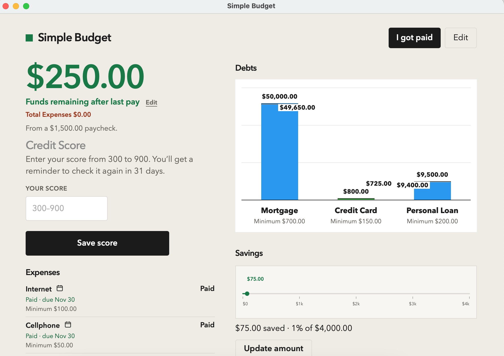
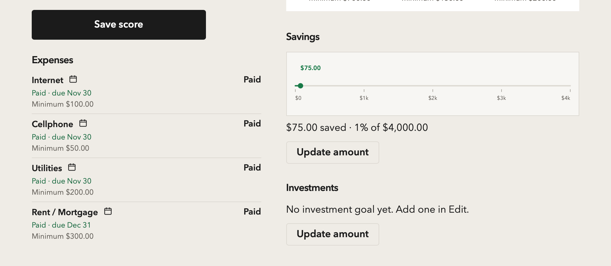
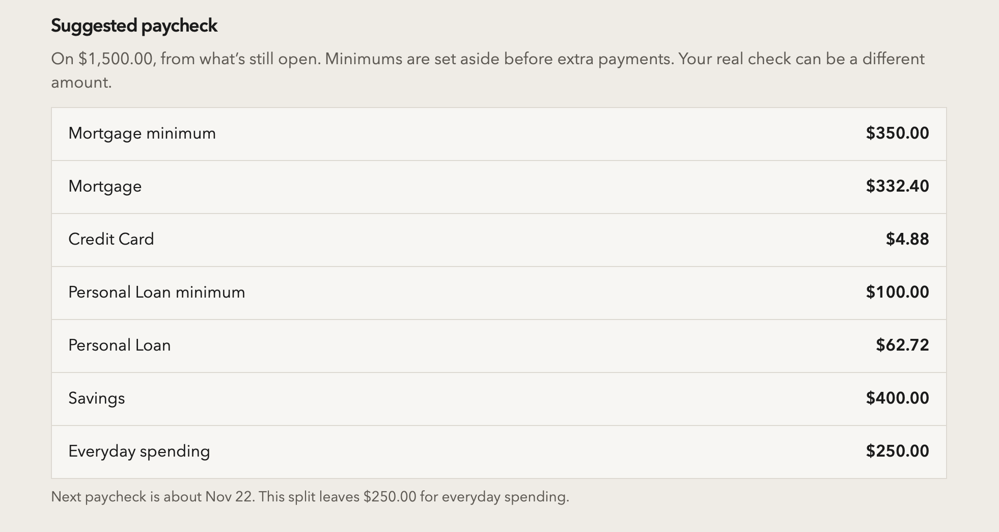
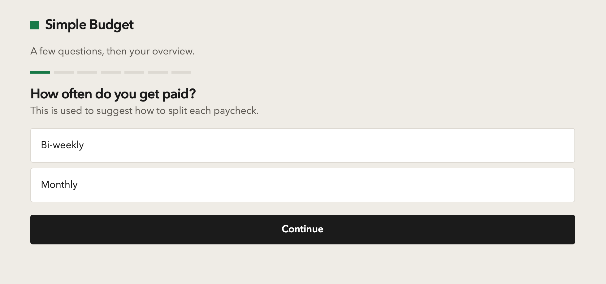
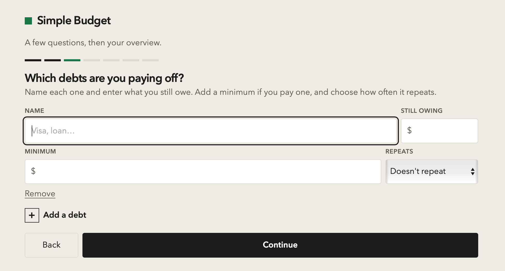

# 💰 Simple Budget

### Personal Finance & Budget Management for macOS, Windows, and Linux

**A simple, private, and intuitive desktop application designed to help you take control of your finances.**

Simple Budget is a cross-platform personal finance application that helps you manage your money, track debt, plan paychecks, and work toward your financial goals.

Instead of complicated spreadsheets or subscription-based budgeting services, Simple Budget provides a straightforward way to organize your financial obligations and understand exactly where your money is going.

Whether you're paying off credit cards, managing monthly expenses, building an emergency fund, or saving for a major purchase, Simple Budget helps you make informed financial decisions.

**The goal is simple: Take the guesswork out of budgeting and make every paycheck count.**


---

## 🖥️ Application Overview



Simple Budget brings your essential financial information into one easy-to-use dashboard.

From a single interface, you can:

- View how much money remains after bills and expenses.
- Monitor outstanding debt balances with visual progress charts.
- Track recurring expenses and upcoming payments.
- Follow progress toward savings and investment goals.
- Monitor your manually entered credit score.
- Review suggested paycheck allocations.

The application begins with a guided setup that helps you enter your income, debts, recurring expenses, and financial goals.

Once configured, Simple Budget uses that information to help you plan how to distribute your paychecks.

---

## ✨ Features

### 📊 Financial Dashboard

Get a complete overview of your financial situation without complicated spreadsheets.

- View remaining funds after paying bills and expenses.
- Monitor outstanding debt balances.
- Visualize debt repayment progress.
- Track savings and investment goals.
- Monitor your credit score.
- Keep your essential financial information organized in one place.

### 💵 Intelligent Paycheck Planning

Take the guesswork out of payday.

- Supports biweekly and monthly pay schedules.
- Enter your actual paycheck amount when you get paid.
- Record bills and expenses you've paid.
- Receive suggested allocations based on your financial obligations.
- Prioritize upcoming bills and minimum debt payments.
- Maintain an everyday spending buffer.
- Allocate remaining funds toward debt repayment, savings, and investments.
- Adjust suggested amounts before recording your paycheck.

### 💳 Debt Management

Stay organized and work toward becoming debt-free.

- Track multiple debts, including loans and credit cards.
- Mark each debt as a credit card or a loan.
- Monitor outstanding balances.
- Configure optional recurring minimum payments.
- Visualize repayment progress through dedicated charts.
- Use Update under the debt chart to add an interest charge to a credit card.

### 📅 Expense Tracking

Manage recurring financial obligations in one place.

- Add bills and recurring expenses.
- Record payment amounts and due dates.
- Supports weekly, biweekly, and monthly billing schedules.
- Configure optional minimum payment amounts.
- Include upcoming expenses in paycheck planning.

### 🎯 Savings & Investment Goals

Turn financial objectives into measurable progress.

- Establish a personal savings goal.
- Set an investment target.
- Monitor progress using dedicated charts.
- Include savings and investments in suggested paycheck allocations.

### 📈 Credit Score Tracking

Monitor your credit-building journey.

- Manually enter your credit score.
- View your recorded score on the dashboard.
- Receive a reminder to update your score after 31 days.

### 🔒 Privacy-First Design

Your financial information stays under your control.

- No account registration.
- No cloud storage.
- No external servers.
- No bank account connection required.
- No subscription required.
- Financial information remains stored locally on your device.

---

## 📸 Application Walkthrough

A closer look at the features and functionality of Simple Budget.

<table>
  <tr>
    <td width="50%" align="center">
      <b>01. Expenses & Financial Goals</b>
      <br><br>
      
      <br><br>
      Manage recurring expenses and track savings and investment goals.
    </td>
    <td width="50%" align="center">
      <b>02. Suggested Paycheck Allocation</b>
      <br><br>
      
      <br><br>
      Review recommended allocations for bills, debt repayment, savings, and investments.
    </td>
  </tr>
  <tr>
    <td width="50%" align="center">
      <b>03. Initial Setup: Income & Debts</b>
      <br><br>
      
      <br><br>
      Enter your income, pay schedule, and outstanding debts.
    </td>
    <td width="50%" align="center">
      <b>04. Initial Setup: Expenses & Goals</b>
      <br><br>
      
      <br><br>
      Configure recurring bills, payment schedules, and financial goals.
    </td>
  </tr>
</table>

---

## 💡 How Simple Budget Works

Simple Budget follows a straightforward workflow designed around your personal financial situation.

### 01. Set Up Your Finances

When you first launch Simple Budget, a guided setup walks you through entering your financial information.

**Income & Debts**

- Enter how much you earn each pay period.
- Choose a biweekly or monthly pay schedule.
- Add outstanding debts, including credit cards, loans, and other balances.
- Configure recurring minimum debt payments.

**Expenses & Financial Goals**

- Add recurring bills and expenses.
- Specify how much each expense costs.
- Enter payment due dates and frequencies.
- Establish savings and investment goals.

Once setup is complete, Simple Budget creates your personalized financial dashboard.

### 02. Record Your Paycheck

When payday arrives, click **"I Got Paid"**.

Enter the amount of your paycheck and record which bills you've paid, including the amount paid toward each obligation.

Simple Budget uses your financial information to help organize your remaining funds.

### 03. Review Suggested Allocations

Based on your income, expenses, outstanding debts, and financial goals, Simple Budget generates a suggested paycheck allocation.

The suggested breakdown prioritizes:

1. Upcoming bills and recurring expenses.
2. Minimum debt payments.
3. An everyday spending buffer.
4. Additional debt repayment.
5. Savings and investment contributions.

You can adjust the suggested amounts to match your actual financial situation before recording your paycheck.

### 04. Track Your Financial Progress

As you continue recording paychecks and payments, your dashboard helps you monitor:

- **Remaining Funds:** See how much money is available after bills and expenses.
- **Debt Repayment:** Visualize progress as outstanding balances decrease.
- **Savings Goals:** Monitor progress toward your savings target.
- **Investment Goals:** Track contributions toward your investment target.
- **Credit Score:** Record your credit score and receive a reminder to update it after 31 days.

**Simple Budget helps turn every paycheck into a clear, actionable financial plan.**

---

## 🛠️ Technical Specifications

| Component | Specification |
|---|---|
| Application | Simple Budget |
| Version | 1.0 |
| Platforms | macOS, Windows, Linux |
| macOS Support | macOS 13 or newer |
| Windows Support | Windows 10 / 11, 64-bit |
| Linux Support | AMD64 / ARM64 |
| Application Type | Standalone desktop application |
| Local Storage Key | `budget-app-v1` |
| Backup Format | JSON |
| macOS Architecture | Universal (Intel & Apple Silicon) |
| Windows Runtime | Microsoft Edge WebView2 |
| Linux Browser Support | Chrome, Chromium, Edge, Brave |
| Desktop Build Requirements | Go 1.26+ |
| macOS Build Requirements | Xcode Command Line Tools |
| Automated Testing | Node.js built-in test runner |
| macOS Bundle ID | `com.jamesfournier.budget` |

Simple Budget operates locally without requiring a backend server, user account, or cloud-based service.

---

## 💾 Data Storage & Backups

Simple Budget stores your budget locally using the storage key `budget-app-v1`.

You can manage your financial information through the application's **File** menu.

| Action | Description |
|---|---|
| **File > Backup Budget** | Export your current budget to a JSON file. |
| **File > Import Budget** | Restore a previously exported budget, with confirmation before replacing existing information. |
| **File > Reset Budget** | Clear the current budget and return to the initial setup. |

**Important:** Budget information is stored locally and is not automatically synchronized between devices. Regular JSON backups are recommended.

---

## 🚀 Installation & Setup

Simple Budget supports macOS, Windows, and Linux.

### 🍎 macOS

**Requirements**

- macOS 13 Ventura or newer.
- Intel or Apple Silicon processor.

**Build from source**

With the Xcode Command Line Tools installed, run:

```bash
./scripts/build-mac-app.sh
```

The build process generates:

```text
dist/
├── Simple Budget.app
└── Simple Budget 1.0.dmg
```

The application is built as a universal macOS binary, supporting both Intel and Apple Silicon Macs.

**Note:** The macOS application is ad-hoc signed. When opening it on another Mac for the first time, Control-click the application and select **Open**.

The bundle identifier `com.jamesfournier.budget` remains consistent between builds to preserve existing saved budget data when updating the application.

### 🪟 Windows

**Requirements**

- Windows 10 or Windows 11, 64-bit.
- Microsoft Edge WebView2 Runtime.

**Application executable**

```text
releases/windows/Simple Budget.exe
```

Launch `Simple Budget.exe` to open the application in its own desktop window.

Windows 11 includes the required WebView2 Runtime, and most up-to-date Windows 10 installations already have it installed.

If the application window does not appear, install the runtime from Microsoft:

[Download Microsoft Edge WebView2](https://developer.microsoft.com/microsoft-edge/webview2/)

**Note:** Windows may display a security warning because the application is unsigned. If you trust the executable and its source, select **More info > Run anyway**.

Budget data is stored locally on the Windows computer.

### 🐧 Linux

Simple Budget includes builds for two Linux architectures.

| Architecture | Executable |
|---|---|
| AMD64 (Intel / AMD 64-bit) | `releases/linux/simple-budget-amd64` |
| ARM64 (including Raspberry Pi 4+) | `releases/linux/simple-budget-arm64` |

**Run the application**

For AMD64 systems:

```bash
chmod +x simple-budget-amd64
./simple-budget-amd64
```

For ARM64 systems, use `simple-budget-arm64` instead.

If Chrome, Chromium, Edge, or Brave is installed, Simple Budget opens in a dedicated application window.

Otherwise, it opens using your default web browser.

Budget backups, imports, and resets are accessible through the application's File menu.

---

## 🌐 Run in a Browser

Simple Budget can also run locally in a web browser for development and testing.

From the project directory, start a local HTTP server:

```bash
python3 -m http.server 5173
```

Open:

http://127.0.0.1:5173

Alternatively, start the development server using:

```bash
npm start
```

**Note:** The browser version maintains its own locally saved budget, separate from the macOS desktop application.

---

## 🔨 Building Windows & Linux Applications

Windows and Linux desktop executables can be generated using Go 1.26 or newer.

Run:

```bash
./scripts/build-desktop.sh
```

The build process generates:

```text
dist/
├── windows/
│   └── Simple Budget.exe
│
└── linux/
    ├── simple-budget-amd64
    └── simple-budget-arm64
```

The build script can generate all three executables from macOS.

The macOS application is built separately using:

```bash
./scripts/build-mac-app.sh
```

---

## 🧪 Testing

Simple Budget includes automated tests for its budgeting functionality.

Run the test suite:

```bash
npm test
```

Or execute the tests directly:

```bash
node --test tests/budget.test.js
```

---

## 🏡 Designed for Everyday Financial Management

Simple Budget was created around a simple idea: **personal finance software should make managing money easier, not more complicated.**

Many budgeting tools depend on subscriptions, cloud services, or direct connections to financial institutions.

Simple Budget takes a different approach by providing a focused, locally operated application built around practical financial goals.

Its design emphasizes:

- **Simplicity:** An easy-to-understand interface without unnecessary complexity.
- **Privacy:** Financial information remains on your computer.
- **Flexibility:** Customize paycheck allocations to suit your circumstances.
- **Financial Awareness:** Understand your obligations before spending.
- **Goal Tracking:** Make measurable progress toward savings, investments, and debt repayment.
- **Accessibility:** Use the application on macOS, Windows, or Linux.

---

### 💰 Take control of your money, one paycheck at a time.

*Simple Budget, Version 1.0*
